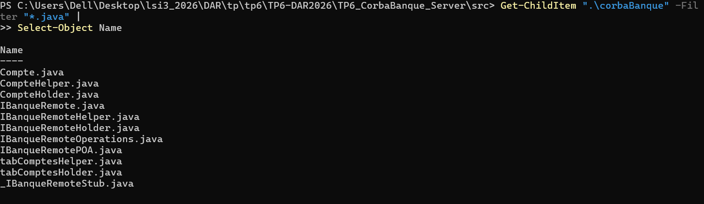
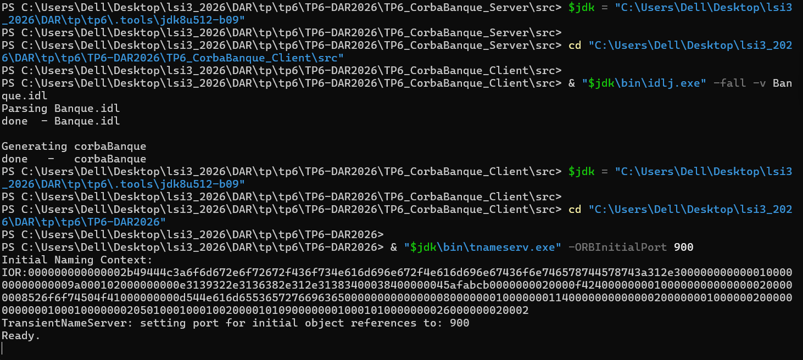
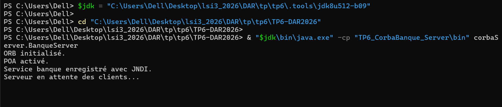
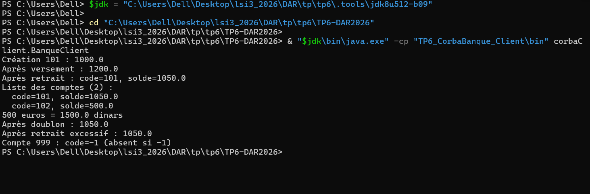

# TP6 - Banque avec CORBA

## Objectif

Appeler à distance les opérations d'un service bancaire avec CORBA. Le client retrouve le serveur par le service de noms.

## Exercice réalisé

Le serveur permet de créer, consulter et lister des comptes, de verser, de retirer et de convertir un montant. Les interfaces CORBA proviennent du fichier `Banque.idl`.

## Lancement

Dans PowerShell, depuis `TP6-DAR2026`, utiliser le JDK 8 présent dans le dossier voisin `.tools` :

```powershell
$jdk = (Resolve-Path '../.tools/jdk8u512-b09/bin').Path
$s = 'TP6_CorbaBanque_Server'
$c = 'TP6_CorbaBanque_Client'
New-Item -ItemType Directory -Force "$s/bin", "$c/bin" | Out-Null
& "$jdk/javac.exe" -encoding UTF-8 -d "$s/bin" (Get-ChildItem "$s/src" -Recurse -Filter '*.java').FullName
& "$jdk/javac.exe" -encoding UTF-8 -d "$c/bin" (Get-ChildItem "$c/src" -Recurse -Filter '*.java').FullName
Copy-Item "$s/src/jndi.properties" "$s/bin/jndi.properties"
Copy-Item "$c/src/jndi.properties" "$c/bin/jndi.properties"
```

Ouvrir trois terminaux dans ce dossier. Lancer dans cet ordre le service de noms, le serveur, puis le client :

```powershell
& "$jdk/tnameserv.exe" -ORBInitialPort 900
& "$jdk/java.exe" -cp 'TP6_CorbaBanque_Server/bin' corbaServer.BanqueServer
& "$jdk/java.exe" -cp 'TP6_CorbaBanque_Client/bin' corbaClient.BanqueClient
```

Définir aussi `$jdk` dans les autres terminaux. Les classes produites par `idlj` sont déjà dans les deux dossiers `src`.

## Captures










