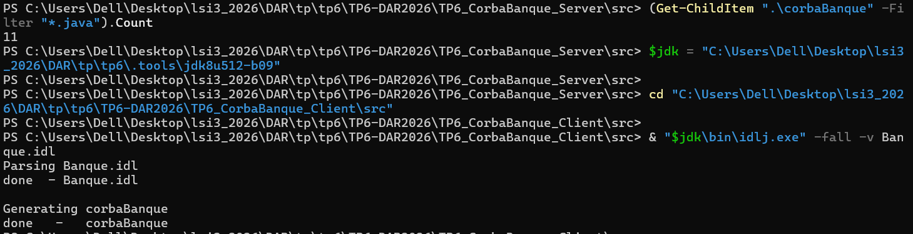

# TP6 - Banque avec CORBA

## Présentation

Ce TP consiste à réaliser une application client-serveur de gestion de comptes bancaires avec CORBA, en suivant le chapitre 3 du cours de Développement d'applications réparties.

Le serveur propose les opérations suivantes :

- Créer un compte avec un code et un solde initial.
- Verser et retirer de l'argent.
- Consulter un compte ou la liste des comptes.
- Convertir un montant en euros vers le dinar tunisien.

## Organisation

Le projet contient deux parties : `TP6_CorbaBanque_Server` et `TP6_CorbaBanque_Client`.

Le fichier `Banque.idl` définit la structure `Compte` et les méthodes du service. Le package `corbaBanque` est généré avec `idlj`. La classe `BanqueImpl` hérite de `IBanqueRemotePOA` et contient les traitements sur les comptes.

Le serveur initialise l'ORB, active le POA et publie le service sous le nom `banque` avec JNDI. Le client recherche ce nom dans l'annuaire, puis utilise `IBanqueRemoteHelper.narrow` pour appeler les méthodes distantes.

Les comptes restent en mémoire pendant l'exécution du serveur. Un compte introuvable est renvoyé avec le code `-1`. Pour la conversion, le taux utilisé dans le cours est de 3 : `500 euros = 1500 dinars`.

## Lancement

Installer le JDK 8 et ajouter son dossier `bin` au `PATH`. Les commandes suivantes sont à exécuter dans PowerShell, depuis le dossier `TP6-DAR2026`.

Vérifier la version de Java :

```powershell
java -version
javac -version
```

Les classes générées par `idlj` sont déjà présentes dans les deux projets. Pour les régénérer, exécuter `idlj -fall -v Banque.idl` depuis le dossier `src` de chaque projet.

Compiler le serveur et le client :

```powershell
$s = 'TP6_CorbaBanque_Server'
$c = 'TP6_CorbaBanque_Client'
New-Item -ItemType Directory -Force "$s/bin", "$c/bin" | Out-Null
javac -encoding UTF-8 -d "$s/bin" (Get-ChildItem "$s/src" -Recurse -Filter '*.java').FullName
javac -encoding UTF-8 -d "$c/bin" (Get-ChildItem "$c/src" -Recurse -Filter '*.java').FullName
Copy-Item "$s/src/jndi.properties" "$s/bin/jndi.properties"
Copy-Item "$c/src/jndi.properties" "$c/bin/jndi.properties"
```

Ouvrir trois terminaux dans ce dossier. Dans le premier, lancer l'annuaire :

```powershell
tnameserv -ORBInitialPort 900
```

Dans le deuxième, lancer le serveur :

```powershell
java -cp 'TP6_CorbaBanque_Server/bin' corbaServer.BanqueServer
```

Dans le troisième, lancer le client :

```powershell
java -cp 'TP6_CorbaBanque_Client/bin' corbaClient.BanqueClient
```

## Résultats

Le client crée le compte `101` avec un solde de `1000`. Après un versement de `200`, le solde devient `1200`. Après un retrait de `150`, il devient `1050`. Un deuxième compte est ensuite créé et les deux comptes sont affichés.

Le client vérifie aussi qu'un doublon et un retrait supérieur au solde sont refusés. Dans ces deux cas, le solde du compte `101` reste égal à `1050`.

## Captures

Vérification du JDK et génération des classes à partir du fichier IDL :




Démarrage de l'annuaire, puis du serveur :


Appels des méthodes depuis le client :


## Synthèse

Le contrat IDL est commun au client et au serveur. Les appels passent par le stub généré, alors que les traitements sont exécutés dans `BanqueImpl` sur le serveur. L'annuaire permet au client de retrouver le service. Il faut donc respecter l'ordre de lancement : annuaire, serveur, puis client.
