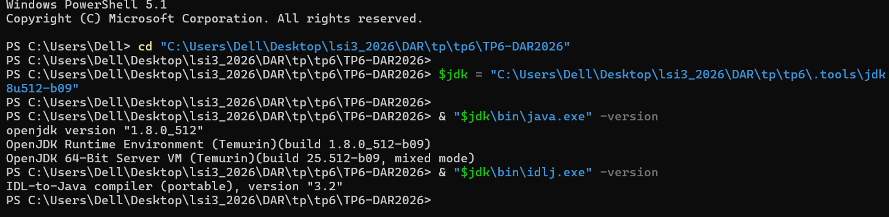
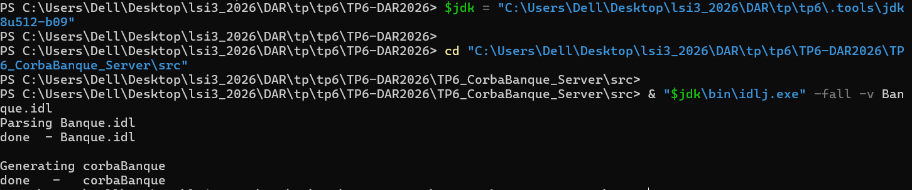

# TP6 – Service Banque en CORBA

**Faculté des Sciences de Sfax (FSS)**  
**Filière :** LSI3  
**Année universitaire :** 2026-2027  
**Matière :** Développement d'Applications Réparties (DAR)  
**Responsable du cours :** Mme Amal ABID  
**Enseignante des TP :** Mme Zeineb DAOUD

## 1. Présentation du TP

L'objectif de ce TP est de réaliser une application répartie client/serveur en Java en utilisant **CORBA (Common Object Request Broker Architecture)**.

L'application permet de gérer des comptes bancaires à distance.

Le serveur propose six opérations :

1. Créer un compte bancaire.
2. Verser une somme d'argent.
3. Retirer une somme d'argent.
4. Consulter un compte.
5. Consulter la liste des comptes.
6. Convertir un montant en euros vers le dinar tunisien.

Pour réaliser cette application, j'ai utilisé plusieurs composants CORBA :

- **IDL :** définit les interfaces et les méthodes distantes.
- **idlj :** génère les classes Java nécessaires à la communication.
- **ORB :** permet la communication entre le client et le serveur.
- **POA :** permet d'exposer l'objet distant côté serveur.
- **Naming Service :** permet d'enregistrer les références des objets distants.
- **JNDI :** permet d'enregistrer et de rechercher le service distant dans l'annuaire.

## 2. Organisation du projet

Le TP contient deux projets Java séparés : un serveur et un client.

```text
TP6-DAR2026/
│
├── TP6_CorbaBanque_Server/
│   └── src/
│       ├── Banque.idl
│       ├── jndi.properties
│       ├── corbaBanque/
│       │   └── 11 fichiers Java générés par idlj
│       ├── service/
│       │   └── BanqueImpl.java
│       └── corbaServer/
│           └── BanqueServer.java
│
├── TP6_CorbaBanque_Client/
│   └── src/
│       ├── Banque.idl
│       ├── jndi.properties
│       ├── corbaBanque/
│       │   └── 11 fichiers Java générés par idlj
│       └── corbaClient/
│           └── BanqueClient.java
│
├── docs/
│   ├── screenshots/
│   └── test-results/
│
├── .gitignore
└── README.md
```

Les fichiers du package `corbaBanque` ont été générés dans chaque projet avec le compilateur `idlj`.

Les dossiers `bin` contiennent les fichiers compilés. Ils ne sont pas conservés dans Git, car ils peuvent être régénérés.

## 3. Environnement de développement

Le projet a été réalisé avec :

- **Système d'exploitation :** Windows 11
- **Langage :** Java
- **JDK :** Eclipse Temurin 8u512-b09
- **Terminal :** Windows PowerShell
- **Gestion de versions :** Git

### Pourquoi utiliser JDK 8 ?

Le TP6 utilise CORBA avec les outils `idlj` et `tnameserv`.

Ces outils étaient inclus dans JDK 8, mais ils ne sont plus disponibles dans les versions récentes comme JDK 21.

Pour réaliser ce TP, j'ai utilisé une version portable de JDK 8 située dans :

```text
C:\Users\Dell\Desktop\lsi3_2026\DAR\tp\tp6\.tools\jdk8u512-b09
```

Cette installation n'a pas nécessité de remplacer JDK 21 ni de modifier les variables d'environnement globales de Windows.

Pour reproduire le TP sur une autre machine, il faut disposer d'un JDK 8 contenant les outils CORBA.

Une distribution JDK 8 peut être téléchargée depuis [Eclipse Adoptium](https://adoptium.net/temurin/releases/?version=8).

## 4. Développement du serveur

### 4.1. Définition de l'interface IDL

Le fichier `Banque.idl` définit les éléments utilisés par le client et le serveur.

Il contient :

- Le module `corbaBanque`.
- La structure `Compte`.
- Le type `tabComptes`.
- L'interface `IBanqueRemote`.

La structure `Compte` contient deux informations :

```idl
struct Compte {
    long code;
    float solde;
};
```

Le type `tabComptes` représente une collection de comptes :

```idl
typedef sequence<Compte> tabComptes;
```

L'interface distante contient six méthodes :

```idl
interface IBanqueRemote {

    void creerCompte(in Compte cpte);

    void verser(in float mt, in long code);

    void retirer(in float mt, in long code);

    Compte getCompte(in long code);

    tabComptes getComptes();

    double conversion(in float mt);
};
```

Les trois premières méthodes utilisent `void`, car l'énoncé ne précise pas de type de retour pour celles-ci.

En Java, le type `long` du langage IDL correspond à `int`.

### 4.2. Génération des classes CORBA

Pour générer les classes Java, j'ai utilisé la commande :

```powershell
idlj -fall -v Banque.idl
```

Le compilateur a généré 11 fichiers Java dans le package `corbaBanque` de chaque projet.

Parmi les fichiers générés :

- `Compte.java`
- `CompteHelper.java`
- `CompteHolder.java`
- `IBanqueRemote.java`
- `IBanqueRemoteOperations.java`
- `IBanqueRemotePOA.java`
- `IBanqueRemoteHelper.java`
- `_IBanqueRemoteStub.java`

Ces classes permettent la communication entre le client et le serveur.

### 4.3. Implémentation BanqueImpl

La classe `BanqueImpl` se trouve dans le package `service`.

Elle hérite de la classe générée :

```java
IBanqueRemotePOA
```

Elle implémente les six méthodes distantes définies dans `IBanqueRemoteOperations`.

Les comptes sont stockés dans une `Map` en mémoire.

Le serveur vérifie les opérations avant de modifier les soldes :

- Un compte ne peut pas être créé deux fois avec le même code.
- Un montant invalide est refusé.
- Un retrait supérieur au solde disponible est refusé.
- Un compte inexistant est signalé par un code `-1` lors de la consultation.

Les méthodes qui accèdent à la collection sont synchronisées pour éviter les problèmes d'accès simultané.

Les données sont conservées uniquement pendant l'exécution du serveur. Elles disparaissent lorsque celui-ci s'arrête.

### 4.4. Conversion de devises

La méthode `conversion` permet de convertir des euros en dinars tunisiens.

Le calcul utilise un taux fixe :

**1 euro = 3 dinars**

Ce taux correspond à un exemple pédagogique et ne représente pas le taux de change réel.

### 4.5. Développement de BanqueServer

La classe `BanqueServer` se trouve dans le package `corbaServer`.

Elle réalise les opérations suivantes :

1. Initialiser l'ORB avec `ORB.init()`.
2. Récupérer la référence `RootPOA`.
3. Activer le `POAManager`.
4. Créer un objet `BanqueImpl`.
5. Transformer le servant en référence CORBA.
6. Enregistrer cette référence dans l'annuaire avec JNDI.
7. Attendre les requêtes des clients avec `orb.run()`.

Le service est enregistré sous le nom :

`banque`

## 5. Développement du client

Le projet `TP6_CorbaBanque_Client` contient sa propre copie de `Banque.idl` et des fichiers Java générés avec `idlj`.

La classe `BanqueClient` se trouve dans le package `corbaClient`.

Elle utilise JNDI pour rechercher la référence de l'objet distant.

La méthode `InitialContext.lookup()` permet de retrouver le service `banque`.

Ensuite, le client utilise :

```java
IBanqueRemoteHelper.narrow()
```

Cette opération permet d'obtenir une référence distante du type `IBanqueRemote`.

Le client peut alors appeler les six méthodes du service bancaire.

### Configuration JNDI

Les deux projets contiennent un fichier `jndi.properties`.

```properties
java.naming.factory.initial=com.sun.jndi.cosnaming.CNCtxFactory
java.naming.provider.url=iiop://localhost:900
```

Le port `900` est utilisé pour accéder au Naming Service CORBA.

Les fichiers `jndi.properties` sont copiés dans les dossiers `bin` afin d'être accessibles depuis le classpath.

## 6. Compilation et exécution

### 6.1. Compilation des projets

Ouvrir PowerShell dans le dossier `TP6-DAR2026`.

Définir les chemins :

```powershell
$jdk = 'C:\Users\Dell\Desktop\lsi3_2026\DAR\tp\tp6\.tools\jdk8u512-b09\bin'
$s = 'TP6_CorbaBanque_Server'
$c = 'TP6_CorbaBanque_Client'
```

Créer les dossiers de compilation :

```powershell
New-Item -ItemType Directory -Force "$s/bin", "$c/bin" | Out-Null
```

**Compilation IDL et Java du serveur :**

```powershell
Push-Location "$s/src"

& "$jdk/idlj.exe" -fall -v Banque.idl

Pop-Location

& "$jdk/javac.exe" -encoding UTF-8 -d "$s/bin" (Get-ChildItem "$s/src" -Recurse -Filter '*.java').FullName

Copy-Item "$s/src/jndi.properties" "$s/bin/jndi.properties"
```

**Compilation IDL et Java du client :**

```powershell
Push-Location "$c/src"

& "$jdk/idlj.exe" -fall -v Banque.idl

Pop-Location

& "$jdk/javac.exe" -encoding UTF-8 -d "$c/bin" (Get-ChildItem "$c/src" -Recurse -Filter '*.java').FullName

Copy-Item "$c/src/jndi.properties" "$c/bin/jndi.properties"
```

Les compilations des deux projets ont réussi avec JDK 8.

### 6.2. Exécution

L'application nécessite trois terminaux PowerShell.

Il faut respecter l'ordre suivant :

**Naming Service → Serveur CORBA → Client CORBA**

Dans chaque terminal, définir le chemin vers JDK 8 :

```powershell
$jdk = 'C:\Users\Dell\Desktop\lsi3_2026\DAR\tp\tp6\.tools\jdk8u512-b09\bin'
```

**Terminal 1 : Naming Service**

```powershell
& "$jdk/tnameserv.exe" -ORBInitialPort 900
```

Le Naming Service démarre sur le port `900`.

Le terminal affiche notamment :

```text
TransientNameServer: setting port for initial object references to: 900
Ready.
```

Il faut garder ce terminal ouvert.

**Terminal 2 : serveur CORBA**

```powershell
& "$jdk/java.exe" -cp 'TP6_CorbaBanque_Server/bin' corbaServer.BanqueServer
```

Le serveur initialise CORBA et publie son service dans l'annuaire.

Il doit rester ouvert pendant les appels du client.

**Terminal 3 : client CORBA**

```powershell
& "$jdk/java.exe" -cp 'TP6_CorbaBanque_Client/bin' corbaClient.BanqueClient
```

Le client retrouve le service distant et exécute les opérations bancaires.

Après les tests, le serveur et le Naming Service peuvent être arrêtés avec `Ctrl + C`.

## 7. Tests réalisés

Les tests ont été effectués avec JDK 8 sur Windows 11.

Les générations IDL et les compilations Java des deux projets ont réussi.

Les résultats réels des tests sont également enregistrés dans `docs/test-results/`.

### 7.1. Tests des opérations bancaires

| Opération | Résultat obtenu |
|---|---|
| Création du compte 101 | Solde initial : 1000.0 |
| Versement de 200 | Nouveau solde : 1200.0 |
| Retrait de 150 | Nouveau solde : 1050.0 |
| Consultation du compte 101 | Code : 101, solde : 1050.0 |
| Liste des comptes | Deux comptes : 101 et 102 |
| Conversion de 500 euros | 1500.0 dinars |

### 7.2. Tests supplémentaires

J'ai également testé plusieurs situations particulières.

**Création d'un compte en doublon :**

Le programme a refusé de créer un deuxième compte avec le code `101`. Le solde est resté inchangé à `1050.0`.

**Retrait supérieur au solde disponible :**

Une tentative de retrait de `2000` a été refusée. Le solde est resté à `1050.0`.

**Consultation d'un compte inexistant :**

La consultation du compte `999` a retourné :

```text
Compte 999 : code=-1 (absent si -1)
```

**Naming Service indisponible :**

Le client a affiché une erreur de connexion CORBA.

**Serveur bancaire indisponible :**

Lorsque l'annuaire fonctionnait mais que le service bancaire n'était pas enregistré, le client a obtenu une `NameNotFoundException`.

Ces essais ont permis de vérifier le fonctionnement de la communication distante et la gestion des cas particuliers.

### 7.3. Résultat du client

La sortie réelle obtenue dans PowerShell est :

```text
Création 101 : 1000.0
Après versement : 1200.0
Après retrait : code=101, solde=1050.0
Liste des comptes (2) :
  code=101, solde=1050.0
  code=102, solde=500.0
500 euros = 1500.0 dinars
Après doublon : 1050.0
Après retrait excessif : 1050.0
Compte 999 : code=-1 (absent si -1)
```

Les résultats affichés par le client proviennent des appels aux méthodes du serveur CORBA.

## 8. Captures d'écran

Les captures suivantes présentent les principales étapes de réalisation et de test du TP6.

### 8.1. Vérification de JDK 8

Vérification de la version Java utilisée pour exécuter les outils CORBA.



### 8.2. Compilation IDL du serveur

Compilation du fichier `Banque.idl` avec `idlj -fall -v Banque.idl`.



### 8.3. Classes CORBA générées

Vérification des fichiers Java générés automatiquement dans le package `corbaBanque`.


### 8.4. Compilation IDL du client

Génération des fichiers CORBA nécessaires au client.


### 8.5. Démarrage du Naming Service

Lancement de `tnameserv` sur le port `900`.

Le message `Ready.` confirme que l'annuaire est disponible.


### 8.6. Démarrage du serveur CORBA

Exécution de `BanqueServer` et publication du service bancaire à travers JNDI.


### 8.7. Tests du client CORBA

La capture suivante regroupe les résultats des différentes opérations bancaires effectuées depuis le client :

- Création du compte `101` avec un solde initial de `1000.0`.
- Versement de `200`, donnant un solde de `1200.0`.
- Retrait de `150`, donnant un solde de `1050.0`.
- Consultation de deux comptes.
- Conversion de `500` euros en `1500.0` dinars.
- Vérification du refus d'un compte en doublon.
- Vérification du refus d'un retrait excessif.
- Consultation du compte inexistant `999`.

**Résultat complet de l'exécution du client :**


Cette capture montre le fonctionnement des six opérations demandées ainsi que les tests supplémentaires.

## 9. Synthèse

Ce TP m'a permis de comprendre le fonctionnement de CORBA pour développer une application répartie en Java.

J'ai appris à définir les opérations distantes dans un fichier IDL, puis à utiliser le compilateur `idlj` pour générer les classes nécessaires à la communication.

Côté serveur, j'ai utilisé un servant Java, l'ORB et le POA pour exposer les méthodes bancaires.

Côté client, j'ai appris à rechercher un objet distant avec JNDI et à utiliser `narrow()` pour obtenir une référence permettant d'appeler ses méthodes.

J'ai également compris l'importance du Naming Service, qui doit être démarré avant le serveur et le client.

Contrairement à une communication utilisant directement les sockets, CORBA permet au client d'invoquer les opérations d'un objet distant à travers une interface définie en IDL.

## 10. Dépôt du projet

Le projet est préparé sous le nom :

**TP6-DAR2026**

Il contient les deux projets Java, les fichiers IDL, les classes CORBA générées, les configurations JNDI, les résultats des tests et les captures d'écran.

